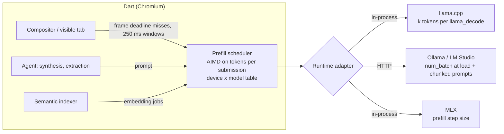

# Application plan: Stage 1 findings, Stage 2 design, and what goes to Dart

Author: Abhinav Pangaria. Written 22 Oct 2026, after all Stage 1 runs finished.
Data: `bench/results/bench.db`, `bench/reports/report.md` (697 trials, 0 errors, 5.7 h).

## 1. What Dart says, in its own words

Quoted from dartbrowser.com (product, features, research, careers) and DBR-2026-05.

| Source | What it says | Why it matters here |
|---|---|---|
| DBR-2026-05 | "A model that starves the compositor produces a janky browser, which testers blamed on the browser rather than the model." | Dart has seen the problem in its own testing |
| DBR-2026-05 | "TTFT is dominated by prompt processing, and a browser agent's prompts are long" | Prompt processing is prefill, the phase I found causes the drops |
| DBR-2026-05 | Recommended tier is 7–9B at Q4_K_M on 16 GB. 3B Q4 at 4k: 210 ms, 9B: 640 ms, 14B: 1,490 ms. Cold or cached is not stated | Section 2, finding F4 |
| DBR-2026-05 | "We are particularly interested in results from hardware slower than anything in our sample" | They are asking for exactly this kind of outside measurement |
| DBR-2026-05 | Runtimes: llama.cpp b4021, Ollama 0.5.4, MLX 0.21 | Stage 2 has to work across runtimes it doesn't own |
| Research agenda, local inference | "without the browser becoming unusable while they do"; open problem: "Speculative decoding schedules that yield to the compositor under load" | My work answers this, and corrects which phase it applies to |
| Research agenda, retrieval | open problem: "Incremental index maintenance that never competes with rendering" | Second workload for the same scheduler |
| DBT-2026-09 (not public) | "Scheduling on-device inference against a render loop": why background embedding is capped at 12% of a core | They already schedule on CPU. My finding is GPU contention, which a core cap doesn't touch. Ask research@ for a copy before sending |
| Product | Main use: "Synthesise, don't search" across tabs and history, with citations, plus a background semantic index (~330 ms per article) | Long prompts and short answers, so the workload is mostly prefill |
| Careers, AI Engineer | "Integrate local runtimes and keep them fast on ordinary consumer hardware"; "Benchmark honestly and publish the numbers, including the bad ones"; "A healthy suspicion of benchmarks, including your own" | The closest role. There is no SDE-1 listing, so apply to this role or as a general application ("describe what you'd build") |

## 2. What I found (Stage 1, M4 Pro 24 GB, 120 Hz, llama.cpp 0.7.0, Brave 1.97)

Each finding carries its evidence and what would make it wrong.

**F1. On GPU-heavy pages, prefill at the default batch drops most frames, and decode doesn't.**
- 7B Q4_K_M prefilling a 4k-token page at ubatch 512 drops this share of frames:
  - WebGL Aquarium: 82.7%, at 39 fps
  - own shader page: 63.7%
  - MotionMark CanvasArcs: 30.4%
  - BBC News and the light page: 0%
  - every page: 0% at idle with no model loaded
- Decode drops 0–0.1% on every GPU-heavy page, for 3B, 7B and 14B.
- Evidence of cause:
  - drops follow batch size: 63% at ubatch 512 and 128, 1.3% at 64
  - CPU-only prefill drops 0.1% but takes 104 s
  - gaps between 128-token chunks don't help (34–38%)
- Would be wrong if a runtime Dart uses (Ollama, MLX) or Dart's Chromium schedules GPU work differently. Phase 0 tests Ollama.

**F2. A fixed small batch fixes 7B on this machine, at a cost.**
- ubatch 64 brings Aquarium and Arcs to 0% and the shader page to 1.3%.
- Its TTFT cost on heavy pages is +4% to +11%.
- Pages that were already smooth pay too: BBC +5.5%, light page +4.5%.

**F3. The safe batch size depends on the model, so it will depend on the machine.**
- ubatch 64 fixes 3B (69% → 0%) and 7B, but 14B still drops 31%.
- A value safe for 14B (≤ 32) costs 7B about 17% TTFT on every page.
- Inference, not measured: how long one submission blocks a frame scales with work per submission divided by GPU speed. 14B on a 16-core M4 Pro is roughly 7B on an 8–10-core base M-series, which is Dart's 16 GB tier. So 64 may not be enough on the machines Dart cares about most. Phase 0/4 tests this.

**F4. Dart's TTFT figures only fit a cached prompt.**
- Cold 4k on this M4 Pro:
  - 3B: 5.1 s (about 800 tok/s prefill)
  - 7B: 11.4 s
  - 14B: 23.7 s
- Cached (page already in KV cache): 45 ms, 79 ms and 159 ms.
- Dart's 210 ms (3B) and 640 ms (9B) at 4k would need about 19,000 and 6,250 tok/s of cold prefill.
- That is 18–24× what this M4 Pro does (800 tok/s for 3B, 350 for 7B). Even their M4 Max, with about 2.5× the GPU cores, can't close that gap.
- So the figures are almost certainly cached-prefix or short-new-suffix numbers. No model passes the 900 ms limit cold.
- Ask this as a question, not a gotcha: "Was TTFT measured with the page already in the cache?"

**F5. Other Stage 1 results.**
- No 2.3× swap cliff on 24 GB: 18 GB of ballast slows 7B decode by 6%. Swap starts between 8 and 14 GB.
- Q8_0 prefills faster than Q2_K (410 vs 374 tok/s).
- ubatch 2048 drops 2.9% even on the light page.

**Not done:**
- accuracy (needs Dart's 640-item set)
- E3 speculative decoding
- E6 energy (needs root)
- a second machine
- a 9B model
- Dart itself

## 3. The thesis

> Dart's agenda says local models must run "without the browser becoming unusable while they do", and
> lists "speculative decoding schedules that yield to the compositor" as open. On Dart's recommended tier,
> the part that fights the compositor is prefill, not decoding: up to 83% of frames dropped on
> third-party GPU-heavy pages, 0% in decode. A fixed smaller batch fixes it on a fast Mac. The safe size
> moves with model and GPU, and a fixed setting slows pages that never needed it. So Stage 2 is a scheduler
> that sets prefill submission size from missed frame deadlines and adapts to each runtime Dart
> already detects.

This argument holds up because:
- it quotes Dart's own problem statement
- it measures their recommended tier
- it corrects the framing of their open problem with data
- it gives the cheap fix first (batch 64) before asking to build anything

## 4. Stage 2 architecture

### Decisions (ADR style)

**D1. What to control: tokens per GPU submission during prefill.**
- Leave decode alone, because it never dropped frames (F1).
- Gaps don't work (F1). CPU fallback is 9× slower.

**D2. Signal: missed frame deadlines of the frontmost visible tab.**
- Not GPU utilisation, because high utilisation on a light page is harmless (F1, BBC at 0%).
- Prototype: the rAF recorder the harness already injects over DevTools.
- Product: compositor presentation feedback. Where to hook it is Dart's call.

**D3. Controller: AIMD on k (additive increase, multiplicative decrease).**
- Halve k when a window drops more than the page's idle rate. Add 64 while frames are clean.
- Ceiling 1024, because 2048 drops on light pages (F5).
- The floor comes from a device × model table measured by the harness: 64 for 3B/7B on M4 Pro, below 64 for 14B.
- AIMD because a dropped frame is visible at once while a slightly slower read isn't. React fast, recover slowly.

**D4. Runtime adapters, because Dart doesn't own the runtime.**
- In-process llama.cpp:
  - chunked `llama_decode`, so k can change every step
  - the cheapest path, unproven, measured in Phase 1
- Ollama / LM Studio:
  - `num_batch` can only change when the model loads, so k can't change per step there
  - the fallback is the chunked prompts already measured (+23% TTFT at 64 tokens)
- MLX: prefill step size, untested.
- If chunking costs as much as separate requests, fall back to 2–3 preloaded contexts at fixed batch sizes.

**D5. Language: C++.**
- llama.cpp and Chromium are C++, so there is no binding layer.
- Phase 1 can be a Python spike (`llama-cpp-python`) because only the measurement matters there.

### Success criteria (fixed before building)
- GPU-heavy pages: prefill drops ≤ idle + 2 points, for 3B, 7B and 14B (or the equivalent on a base Mac).
- Light pages: TTFT within 2% of ubatch 512.
- Heavy pages: TTFT no worse than the smallest fixed batch that is smooth for that model and machine.
- A heavy page brought to the front mid-prefill is smooth again within 500 ms.
- Results are published including failures: the AI Engineer listing asks for "including the bad ones".

## 5. Plan with exit criteria

Durations are my estimates.

| Phase | Work | Exit criterion |
|---|---|---|
| 0. Close the evidence gaps (1–2 days, before sending) | (a) Ollama with default settings on the heavy page and Aquarium. (b) A 9B-class model (Qwen3-8B or Gemma 2 9B) at ubatch 512/64. (c) An embedding model indexing pages during heavy-page scroll | Each result changes or confirms F1–F3. Every outcome gets reported |
| 1. Knob (week 1) | Chunked `llama_decode` spike, then C++. Compare cost with ubatch 64 and per-request chunking | Cost at k=64 known. Pick the in-process path or the D4 fallback |
| 2. Controller and signal (week 2) | AIMD plus the rAF signal over a local socket. Scenarios: heavy page, light page, a switch mid-prefill | 500 ms recovery, light-page cost ≤ 2% |
| 3. Adapters (week 3) | Ollama adapter (load-time batch plus chunking). MLX probe | Same suite passes, or each gap is documented |
| 4. Second machine and report (week 4) | Base M-series 16 GB. Static 512 vs static 64 vs scheduler. Write-up in DBR style | Device table for two Macs. Report with limits |

## 6. What goes to Dart

1. **An email to careers@dartbrowser.com**, subject "AI Engineer: measured compositor stalls from local prefill". The text is below.
2. **The one-page summary**, `docs/application.html`, hosted or attached, reworked to this framing.
3. **The repository:** harness, raw SQLite data, report, design doc with the pre-registered rule and its amendment.
4. **A 60–90 s screen recording.** Aquarium during 7B prefill at ubatch 512 (39 fps, visibly stuttering), then at ubatch 64 (120 fps), with the frame counter on screen. It shows the problem without any reading.
5. **Before sending:** ask research@dartbrowser.com for DBT-2026-09. If their 12% core cap already covers GPU work, or they found the same thing, rewrite section 3 to build on it rather than repeat it.

### Email draft

> Subject: AI Engineer: measured compositor stalls from local prefill
>
> Hi Dart team,
>
> I'm Abhinav Pangaria, a recent CS graduate. I don't see an SDE-1 listing, so I'm applying to the AI
> Engineer role with work instead of a CV paragraph.
>
> DBR-2026-05 notes that testers blamed the browser for jank caused by the model, and your agenda lists
> scheduling that yields to the compositor as open. I measured it on an M4 Pro with your recommended
> tier (7B Q4_K_M, 4k-token prompts, Chromium with five tabs). Prefill at llama.cpp's default batch
> drops 83% of frames on WebGL Aquarium and 30% on MotionMark CanvasArcs, and 0% on BBC News. Decode drops
> nothing anywhere. A batch of 64 fixes 7B for +4–11% TTFT, but not 14B, which still drops 31%, so I
> expect 64 isn't enough on the base Macs in your 16 GB tier.
>
> I also reran DBR-2026-05's limits. Cold 4k TTFT here is 11.4 s for 7B and 79 ms with the page cached.
> Were your 640 ms and 210 ms figures measured with a cached prefix?
>
> Attached: a one-page summary, the harness and raw data, and a short recording. The Stage 2 plan is a
> prefill scheduler driven by missed frame deadlines, with adapters for llama.cpp, Ollama and MLX.
> Everything is one machine, and the limits are listed up front, including a decision rule I amended
> after seeing data.
>
> Abhinav

## 7. Objections a reviewer will raise, and the answers

| Objection | Answer |
|---|---|
| "One machine, and Brave isn't Dart." | Both are Chromium, and the contention sits below the browser in Metal. Phase 0 adds Ollama and Phase 4 adds a base Mac. The limits are stated up front |
| "Just set batch 64." | Yes, do that now on 7B. The scheduler exists because 64 fails on 14B here and likely on base Macs, and costs light pages 5% |
| "Users summarise articles, not WebGL." | True for most requests, and the page says so. The agent and indexer also run while users scroll maps, docs editors and dashboards. Dart's own testers hit this |
| "rAF isn't the compositor." | Agreed, it's a proxy. The product signal is presentation feedback (D2) |
| "You changed the rule after the data." | Disclosed, with the original verdict still printed. The original rule read one light page |
| "You haven't built anything for Stage 2." | Phase 0 runs before sending. The plan has exit criteria and a fallback for each risk |
